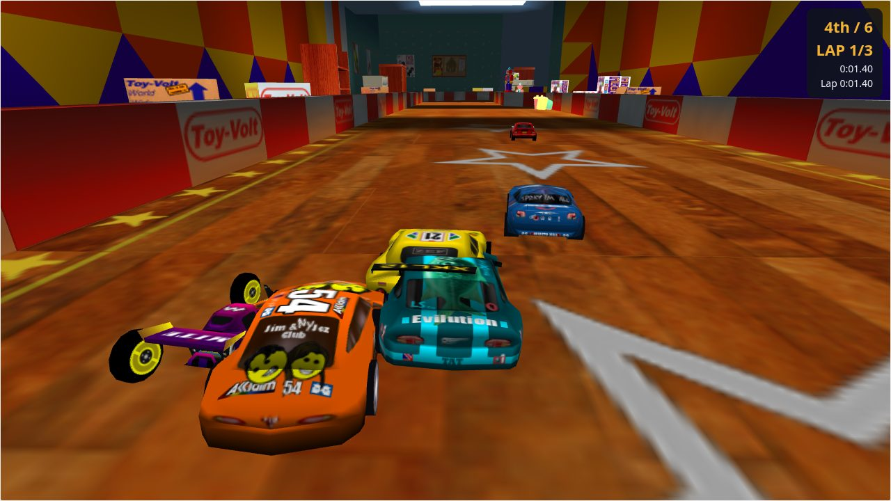
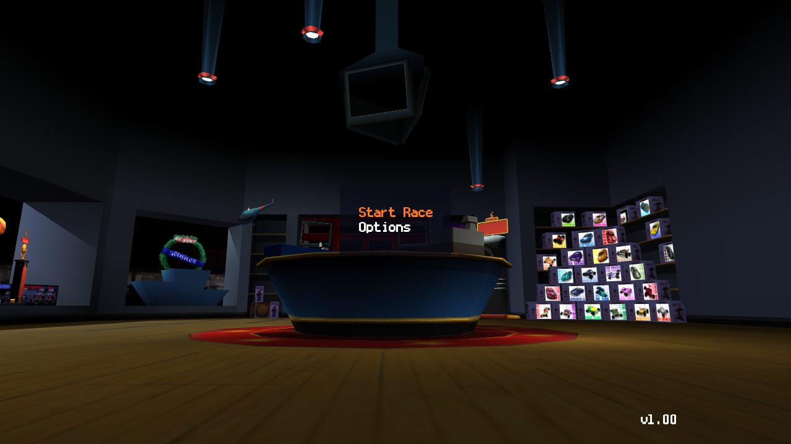
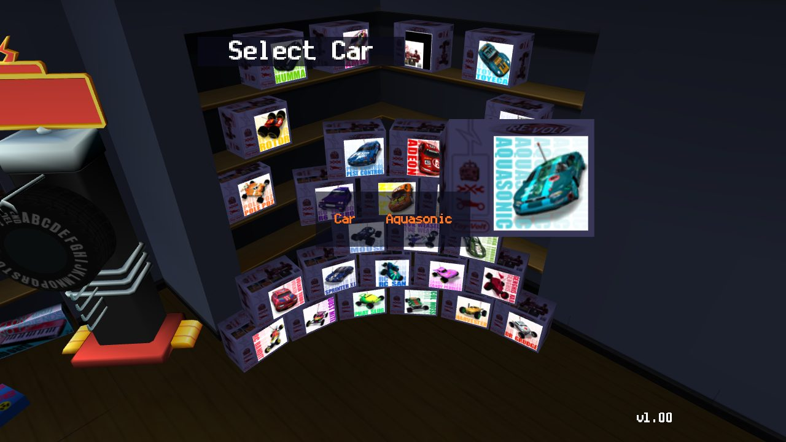

# Re-Volt Web

Play Acclaim's *Re-Volt* (1999) in your browser. This is a new engine written
in Rust and compiled to WebAssembly, with WebGL2 graphics and gamepad
support. It reads **your own copy** of the PC game straight from its disc
image, in the browser. No game data is included, and nothing is uploaded.



<p>
  
  
</p>

## Play

### What you need

- **Your own copy of Re-Volt for PC**, as a disc image: the `.cue` file with
  its `.bin` tracks (for example, ripped from your CD), or an `.iso`. It's been
  tested with the USA release, `Re-Volt (USA) (En,Fr,De,Es,It)`. The console
  versions (PlayStation, N64, Dreamcast) use different formats and won't work.
- **A desktop browser with WebGL2**, such as a recent Chrome, Edge or Firefox.
  It's mainly tested in Chrome.
- **Optional: a gamepad.** Any controller the browser recognises works. Press a
  button once the page has loaded so the browser picks it up.

### Start playing

1. Open the game page: **<https://jasonsperske.github.io/re-volt-web/>**
   (or run it locally, see [Build from source](#build-from-source)).
2. Click **Open disc…** (or drag the files onto the page) and select the
   **`.cue` and all of its `.bin` files together**. Only the first track is
   needed to play. The others are the CD soundtrack, so include them if you
   want music. The files are read in your browser and never leave your computer.
3. You're in the toy shop. Choose **Start Race**, then one of:
   - **Single Race:** race AI opponents, with pickups and weapons.
   - **Time Trial:** race on your own against the clock.
   - **Stunt Arena:** free-roam the stunt park.
4. **Enter Name:** left/right turns the letter wheel, and Enter (or A) picks a
   letter. Turn to **END** and press Enter when you're done.
5. **Select Car:** left/right takes boxes off the shelf. Enter (or A) picks
   one, and the car drops out of its box. The **Workbench** gear in the
   corner (G, or Y on a gamepad) puts the car on the shop counter instead,
   to rename and tune it (see below).
6. **Select Track:** left/right changes the track on the big screen, and Enter
   confirms it.
7. **Summary:** check your choices and select **Start Race**. Wait for the
   3-2-1 countdown, then go.

**Options** in the shop sets the number of cars, laps and pickups, and turns
music and sound effects on or off. **View Credits** shows the original game's
credits, page by page; they're also on the start screen, under **Credits**. The browser remembers your disc, so next
time the game opens straight into the shop.

### The workbench

On the workbench you can rename a car and change its weight, spring
stiffness and damping, suspension travel, tyre grip, engine power, top
speed, steering speed and downforce, each from 50% to 200% of stock.
Changes are saved in your browser for each car and used in every race with
it. **Reset to Stock** puts a car back the way it came.

### VR

With a VR headset (for example a Meta Quest, in its browser), an **Enter VR**
button appears during races. You ride along with the chase camera at RC-car
size, with a panel ahead of you showing your position, lap, weapon and the
countdown. The menus stay on the flat screen, so pausing or finishing a race
leaves VR.

| VR controllers | |
|---|---|
| Accelerate | Right trigger |
| Brake / reverse | Left trigger |
| Steer | Either thumbstick |
| Fire weapon | A |
| Flip car | B |
| Change camera | X |
| Pause (leaves VR) | Y |

### Controls

| | Keyboard | Gamepad |
|---|---|---|
| Accelerate | W or ↑ | RT or A |
| Brake / reverse | S or ↓ | LT or X |
| Steer | A / D or ← / → | Left stick |
| Fire weapon | Space | B or RB |
| Look around | Mouse (click the view first) | Right stick |
| Flip car back onto its wheels | F (or the **Flip car** button) | LB |
| Restart race | R | Y |
| Pause menu | Esc | Start |
| Change camera: chase, far, low, free | C | Back |
| Music / sound on/off | M / N | |

In the menus, use the arrow keys or D-pad to move and change values, Enter or
A to select, and Esc or B to go back. The mouse works too.

### Racing tips

- **Pickups** are the spinning lightning bolts on the track. Drive through one
  and a weapon roulette spins, then fire with Space (or B). You can't pick up
  another weapon until you've used the one you have.
- **Last place gets the better weapons:** shockwaves, ball bearings and the
  occasional Global Pulse.
- **If you flip over**, press F (LB on a gamepad, or the **Flip car** button)
  to turn the car back onto its wheels where it is. R (or Y) restarts the race.

### Troubleshooting

| Problem | Fix |
|---|---|
| Black screen or "WebGL2 is not available" | Use a recent desktop Chrome, Edge or Firefox with hardware acceleration on. |
| "No Re-Volt data track found" | Select the `.bin` files, not just the `.cue`. The first track must be the PC version. |
| No music | Select all the `.bin` tracks together with the `.cue`. Check Options → Audio Settings. |
| Gamepad does nothing | Press any button after the page loads. During a race, the status line at the bottom shows the pad's name once it's connected. |
| Slow on a laptop | Close other tabs and make sure the browser is using the GPU. |

## What's in this version

- **All 13 race tracks and the Stunt Arena, with all 32 cars.**
- **Car physics ported from the original game code:** suspension, tyre grip,
  engine, braking, surfaces and collisions.
- **Pickups and all 10 weapons**, also ported from the original.
- **The original 3-D toy-shop menus:** the same camera moves, font and car boxes.
- **AI opponents, laps, race positions, results, CD music and sound effects.**
- **New in this version:** a workbench for renaming and tuning cars, extra
  camera views, and VR.

The AI drivers and the lap/position rules are new designs built on the game's
own track data. Championship, Multi-Player, Battle Tag, Best Trial Times and
the video/controller settings menus aren't available.

## Build from source

You need Rust with the `wasm32-unknown-unknown` target, plus `wasm-bindgen-cli`
0.2.100 (`cargo install wasm-bindgen-cli --version 0.2.100`).

```sh
npm run build        # builds the complete static site into web/
npm run serve        # serves it at http://localhost:8080
```

Every push to `main` builds the site and publishes it to GitHub Pages
(`.github/workflows/pages.yml`). To host it elsewhere, upload the contents of
`web/` after `npm run build` to any static host; no special headers are needed. Never upload disc images or files taken from the game;
`.gitignore` excludes them.

### Tests

```sh
npm test             # native: every track and car, physics, AI laps, weapons
npm install && npm run e2e    # headless Chrome; needs `npm run serve` running
npm run e2e:loading  # the loading bar, from a fresh pick and from the browser cache
npm run e2e:credits  # the credits, on the start screen and in the toy shop
npm run e2e:workbench  # renaming and tuning a car on the workbench
npm run e2e:vr       # VR mode, with a stand-in WebXR device
npm run tour         # screenshots every menu screen into e2e/shots/
npm run screenshots  # retakes the README screenshots in docs/screenshots/
```

The tests look for `Re-Volt (USA) (En,Fr,De,Es,It) (Track 01).bin` in the
project folder, or the path in `REVOLT_DISC`, and skip if neither is there.

### Project layout

```
src/disc.rs      reads the disc image (cue/bin or iso) on demand
src/formats/     parsers for the game's model, level, collision, car and image files
src/car.rs       car physics ported from REVOLT.EXE
src/weapons.rs   pickups and weapons ported from REVOLT.EXE
src/frontend.rs  toy-shop menus: camera, props, name wheel, strings
src/ai.rs        AI drivers following the game's racing line
src/race.rs      laps and race positions
src/camera.rs    chase and free cameras
src/web/         browser glue: WebGL2 renderer, input, gamepad
web/             the page: index.html, menus, CD music, sound effects
tests/, e2e/     native tests and the headless browser tests
docs/formats.md  the game's file formats
```

## Legal

Re-Volt is © 1999 Acclaim Entertainment and its successors. This is an
unofficial fan project, not affiliated with or endorsed by the rights holders.
It contains no game data: to play, you need your own copy of the game. The
screenshots above show the original game's artwork, running in this engine.
